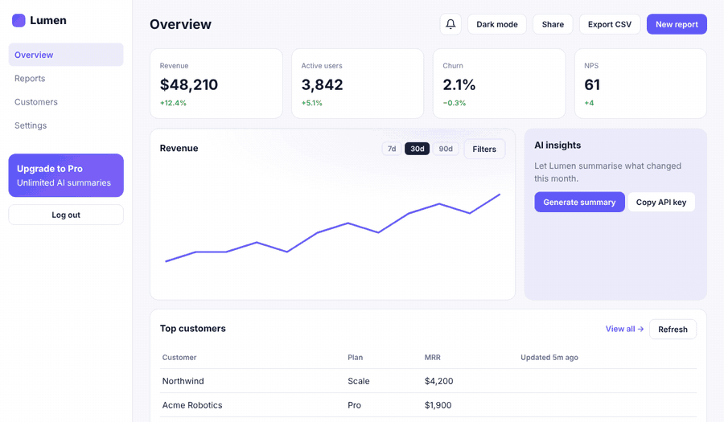
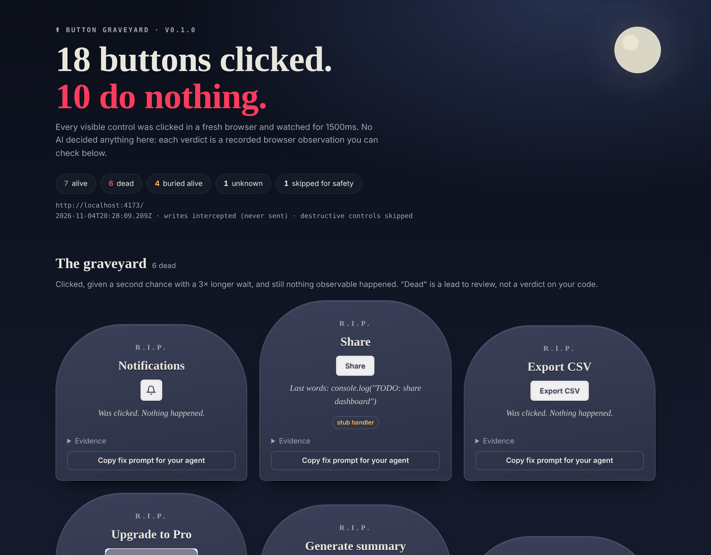
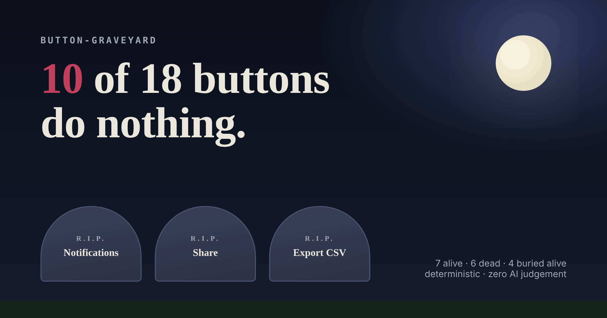
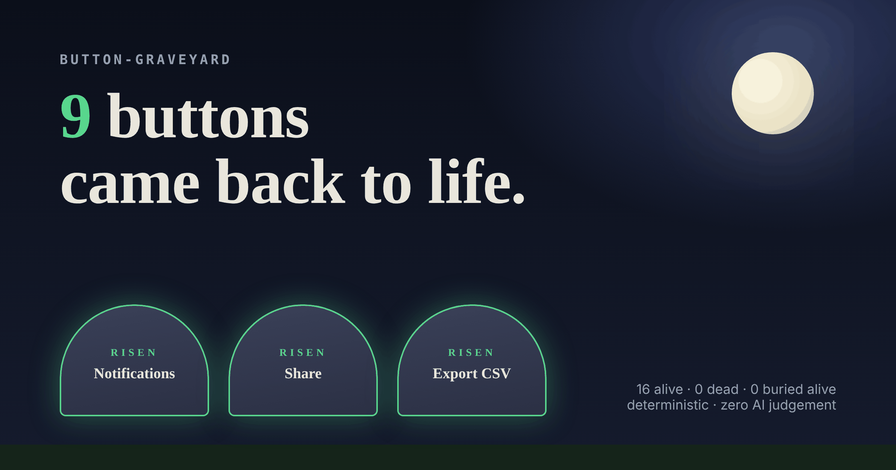

<div align="center">

# 🪦 button-graveyard

### Your AI built 18 buttons. 10 of them do nothing.

An agent skill that **clicks every button in your app** in a real browser, buries the dead ones, fixes them, and **proves they came back to life**.

No AI judges anything: every verdict is a recorded browser observation. No API key needed.

[English](README.md) · [简体中文](README.zh-CN.md)



</div>

---

## Install (30 seconds)

Works with Claude Code, Codex, Cursor, Gemini CLI, OpenCode, and any other agent that reads `SKILL.md`.

```bash
npx skills add ada-lc826/button-graveyard
```

<details><summary>Other ways to install</summary>

**Claude Code plugin**

```
/plugin marketplace add ada-lc826/button-graveyard
/plugin install button-graveyard@button-graveyard
```

**Manual:** copy `skills/button-graveyard/` into `~/.claude/skills/` (Claude Code) or `.agents/skills/` (Codex and others).

**No agent at all:**

```bash
git clone https://github.com/ada-lc826/button-graveyard && cd button-graveyard
node skills/button-graveyard/scripts/graveyard.mjs http://localhost:3000
```

</details>

Then ask your agent:

> **find the dead buttons in my app**

It starts your dev server, clicks everything, shows you the graveyard, offers to fix it, and rescans to prove the fix.

## What you get



A self-contained HTML report: one tombstone per dead control, its **last words** (`console.log("TODO: share dashboard")`), before/after screenshots, and a **Copy fix prompt** button. There's also JSON for your agent, Markdown for your PR, and a share card for your timeline:

| Before | After `--compare` |
|---|---|
|  |  |

## How it decides a button is dead

Every control gets its own **fresh browser context**. The page's background noise (clocks, polling, carousels) is measured first and subtracted. Then the control is clicked and watched for:

`navigation` · `new tab` · `download` · `dialog` · `file picker` · `network request` · `DOM / ARIA change` · `localStorage / cookies` · `clipboard` · `scroll` · `print` · `canvas pixels`

If none of those happen, it gets a second chance with a **3× longer wait**. If it still does nothing, it's buried.

| Verdict | Meaning |
|---|---|
| ✝ **dead** | Clicked twice, nothing observable. Causes: `no-op`, `stub` (only logs) or `crashed` (the handler threw) |
| ▣ **buried alive** | The button exists, but an invisible layer (`<div class="glow">`) eats every click |
| **unknown** | No reliable observation, e.g. it's already the selected tab. Never counted as dead |
| **skipped** | Deliberately not clicked: looks destructive, disabled, or an external link |
| **alive** | Something observable happened. That doesn't mean it's *correct* |

## Safe by default

- **Localhost / `file://` only.** Other hosts need `--i-own-this-app`.
- **Writes never leave the browser.** POST/PUT/PATCH/DELETE fired by a click are intercepted and recorded (the button still counts as alive), but never sent. Use `--allow-writes` to turn this off.
- **Destructive-looking controls are skipped:** delete, pay, checkout, logout, send, deploy, and Chinese equivalents (删除, 支付, 退出登录…). Use `--allow-danger` to include them.
- **Analytics are blocked**, so scanning doesn't pollute your metrics.

## The agent can't cheat

The skill tells your agent to make each control do **what its label promises**. A fake toast or dummy `setState` that only exists to fool the scanner is explicitly banned. If a feature doesn't exist, the agent has to ask you: build it, hide it, or say "coming soon".

## CI: catch dead buttons in every PR

```yaml
- run: npm run dev &            # start your app
- uses: ada-lc826/button-graveyard@v0
  with:
    url: http://localhost:3000
```

This posts the graveyard to the job summary, uploads the full report as an artifact, and fails the job if anything is dead (`fail-on-dead: false` to only report).

## Options

```
--out <dir>         output folder (default .button-graveyard)
--wait <ms>         observation window per click (default 1500)
--compare <json>    previous graveyard.json → resurrected / newly dead
--only / --skip     regex on label or selector
--selector <css>    extra elements to treat as controls
--fail-on-dead      exit 1 if anything is dead or blocked
--allow-writes      let click-triggered writes reach your server
--allow-danger      also click destructive-looking controls
```

## Try the demo yourself

```bash
git clone https://github.com/ada-lc826/button-graveyard && cd button-graveyard
npm i && npx playwright install chromium
npm run demo     # scans demo/broken, swaps in demo/fixed, rescans with --compare
npm test         # 44 regression checks: every verdict branch has a fixture
```

## Honest limits

- It only tests controls visible on load. Items in closed menus or later wizard steps need their own route.
- Pages behind login need a dev bypass or a seeded session.
- Backend-only effects with no request, and IndexedDB, aren't observed.
- Actions that change nothing from the current state, like "Reset" when everything is already at its default, can look dead.
- **Alive ≠ correct.** It proves something happened, not that the right thing happened.

## How it compares

| | button-graveyard | Static "read the code" skills | Session replay dead-click tools | AI explorer agents |
|---|---|---|---|---|
| Runs a real browser | ✅ | ❌ | ✅ (real users) | ✅ |
| Before you ship | ✅ | ✅ | ❌ after launch | ✅ |
| Verdict made by | recorded events | an LLM | real users | an LLM |
| API key needed | no | via your agent | SaaS account | yes |
| Fixes, then proves the fix | ✅ `--compare` | ❌ | ❌ | partly |

## License

MIT. If this saved your demo, a ⭐ helps other people find it.
