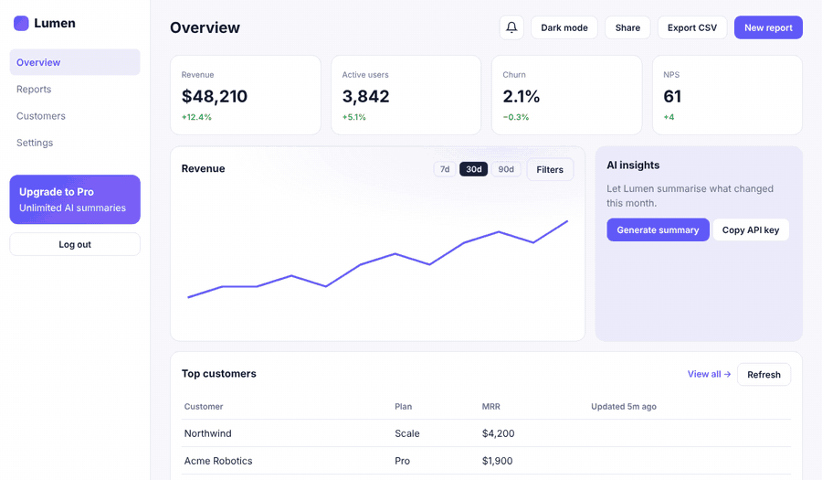
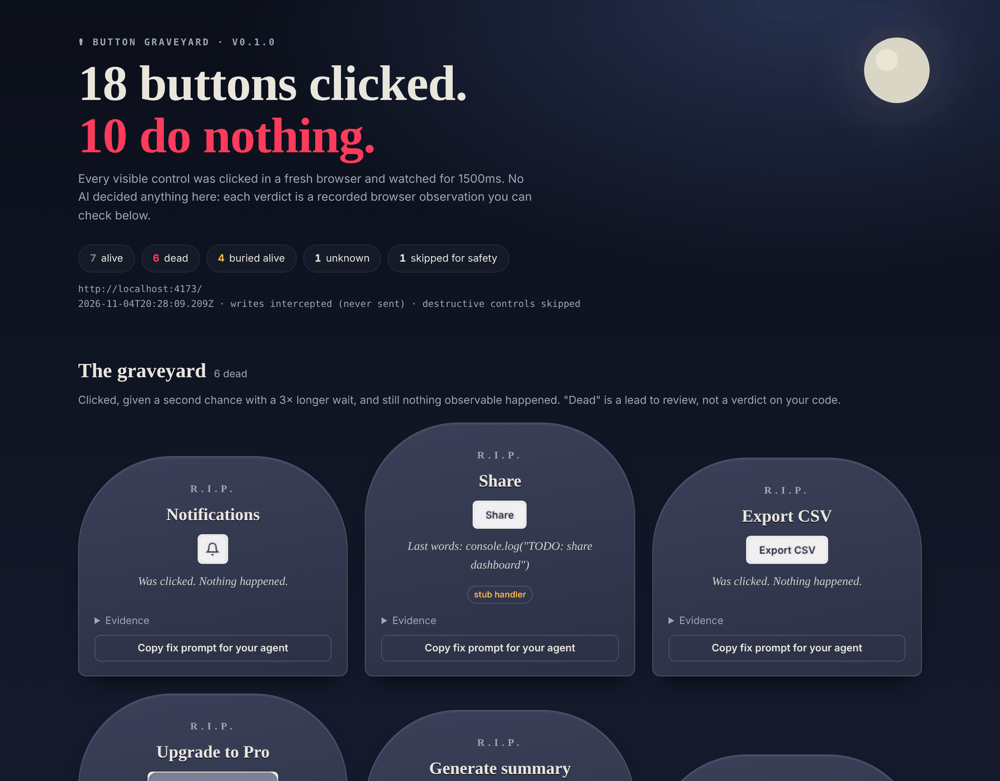

<div align="center">

# 🪦 button-graveyard · 按钮墓地

### 你的 AI 做了 18 个按钮，其中 10 个点了没反应。

一个 Agent Skill：在真实浏览器里**把你应用里的每个按钮都点一遍**，把"死按钮"埋进墓地，修好它们，再**复扫证明它们真的复活了**。

全程没有 AI 做判断，每条结论都是浏览器里录到的可观察事件。不需要 API Key。

[English](README.md) · [简体中文](README.zh-CN.md)



</div>

---

## 安装（30 秒）

支持 Claude Code、Codex、Cursor、Gemini CLI、OpenCode，以及所有能读 `SKILL.md` 的 Agent。

```bash
npx skills add ada-lc826/button-graveyard
```

Claude Code 插件安装：

```
/plugin marketplace add ada-lc826/button-graveyard
/plugin install button-graveyard@button-graveyard
```

然后对你的 Agent 说：

> **帮我找出应用里点了没反应的按钮**

它会启动 dev server，逐个点击，给你看墓地报告，征得同意后修复，最后复扫证明修好了。

## 你会得到什么



- **HTML 报告**：每个死按钮一块墓碑，附"遗言"（比如 `console.log("TODO: share dashboard")`）、点击前后截图，以及"一键复制修复提示词"
- **JSON**：给 Agent 读
- **Markdown**：贴到 PR 里
- **分享卡片 PNG**：发朋友圈或 X

## 怎么判定"死了"

每个控件都在**全新的浏览器上下文**里测试。先测出页面本身的背景噪声（时钟、轮询、轮播）并扣除，再点击，观察以下信号：

导航 · 新标签页 · 下载 · 弹窗 · 文件选择器 · 网络请求 · DOM/ARIA 变化 · 本地存储/Cookie · 剪贴板 · 滚动 · 打印 · Canvas 像素

一个信号都没有，就再给一次 **3 倍等待时间** 的机会。还是没反应，才下葬。

| 结论 | 含义 |
|---|---|
| ✝ **dead 死亡** | 点了两次，毫无可观察效果。原因分三种：`no-op`（什么都没发生）、`stub`（只打了日志）、`crashed`（处理函数抛错） |
| ▣ **buried alive 活埋** | 按钮存在，但上面盖着一层透明元素（如 `<div class="glow">`），点击被吃掉了 |
| **unknown 未知** | 无法可靠观察，比如它本来就是当前选中的标签。不计为死亡 |
| **skipped 跳过** | 有意不点：看起来有破坏性、被禁用，或者是外链 |
| **alive 存活** | 观察到了效果。注意：不代表功能*正确* |

## 默认安全

- **只扫 localhost / `file://`**。其他域名必须显式加 `--i-own-this-app`
- **写请求不出浏览器**：点击触发的 POST/PUT/PATCH/DELETE 会被拦截并记录（照样算存活），但不会发到服务器
- **危险控件自动跳过**：删除、支付、结算、退出登录、发送、部署等（中英文都识别）
- **屏蔽统计埋点**：扫描不会污染你的数据

## Agent 作弊不了

Skill 明确要求 Agent 让每个控件"做到它标签上写的事"。禁止加假 toast、空 `setState` 之类只为骗过扫描器的东西。功能确实不存在时，Agent 必须问你：实现它、隐藏它，还是诚实地标成"即将推出"。

## CI 集成

```yaml
- run: npm run dev &
- uses: ada-lc826/button-graveyard@v0
  with:
    url: http://localhost:3000
```

## 自己跑一遍演示

```bash
git clone https://github.com/ada-lc826/button-graveyard && cd button-graveyard
npm i && npx playwright install chromium
npm run demo
npm test
```

## 诚实的局限

- 只测试页面加载时可见的控件。收起的菜单、向导后续步骤里的按钮，需要单独扫对应路由
- 需要登录的页面，得有开发环境的免登录方式或预置会话
- 观察不到纯后端效果（没发请求的），也观察不到 IndexedDB
- 在当前状态下本来就不会产生变化的操作（比如已经是默认值时点"重置"）可能会被误判为死按钮
- **存活 ≠ 正确**。它证明"发生了什么"，不证明"发生的是对的事"

MIT 协议。如果它救了你的 demo，点个 ⭐ 能让更多人看到它。
